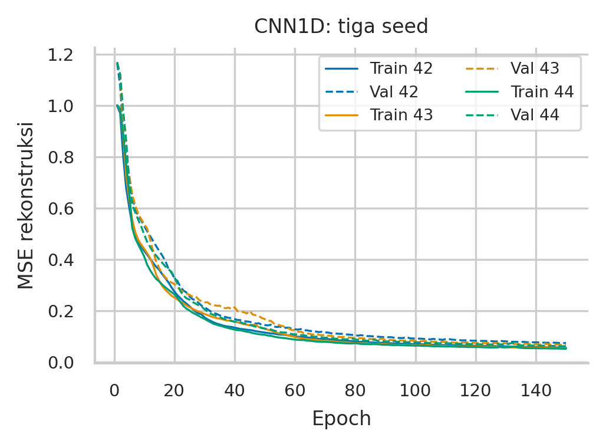
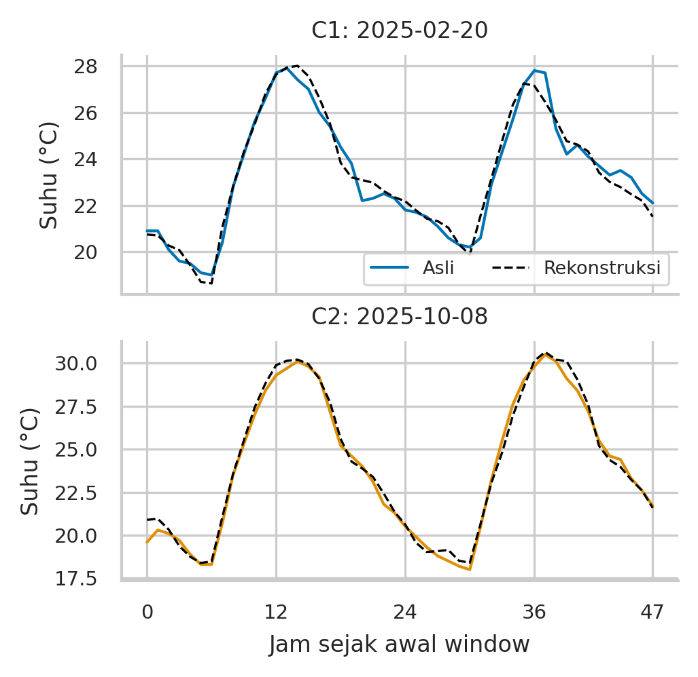
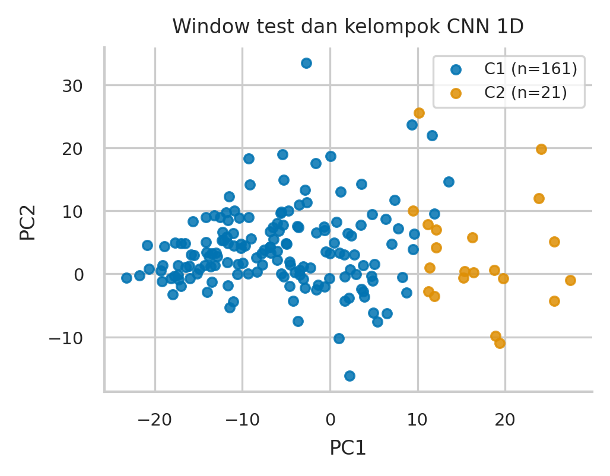
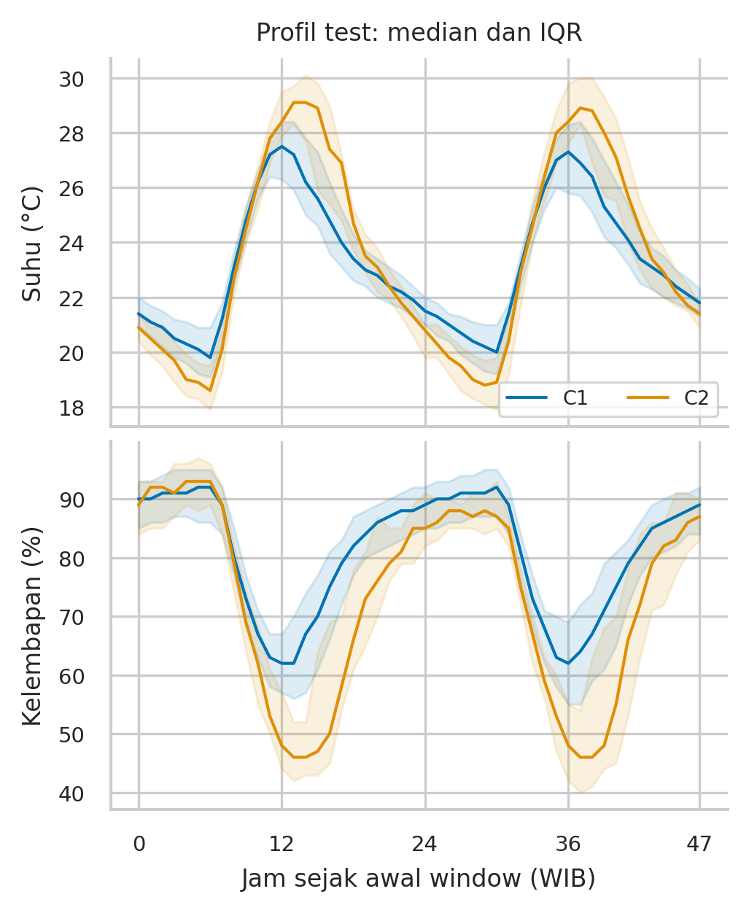
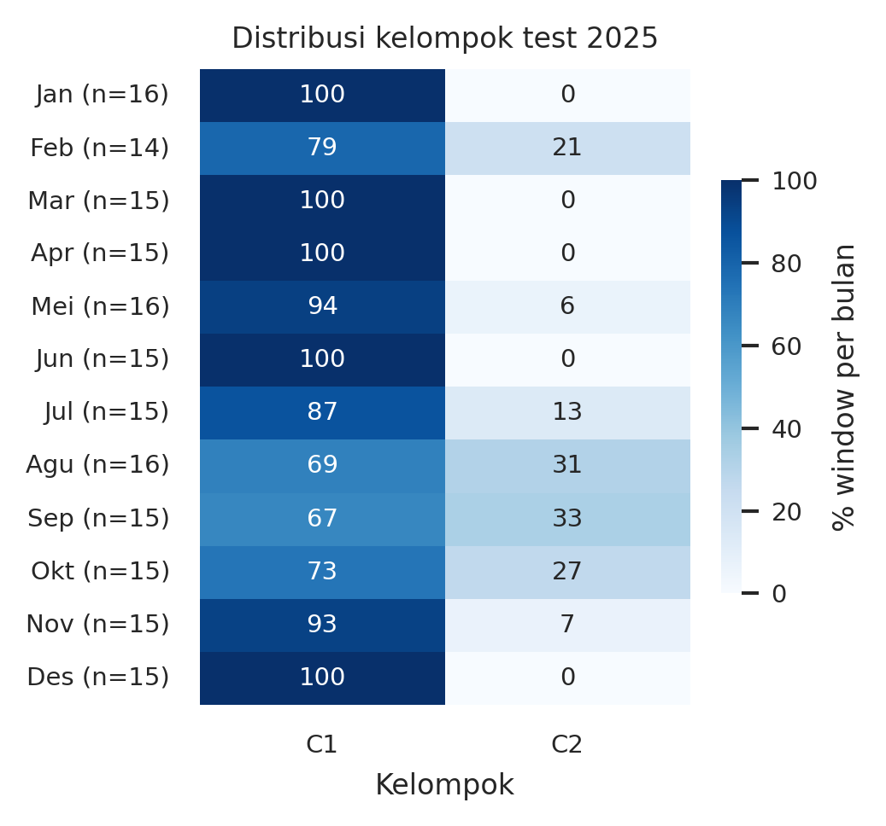
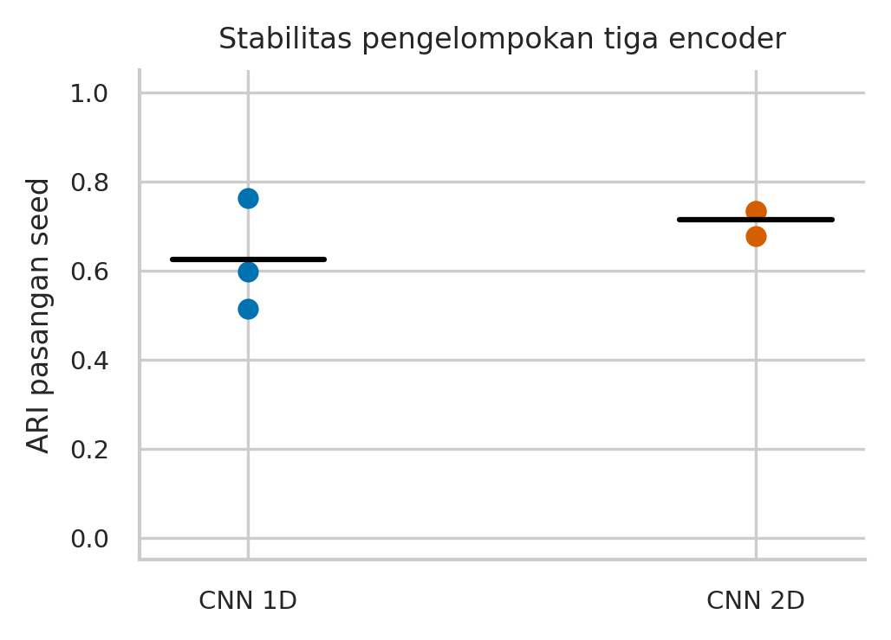
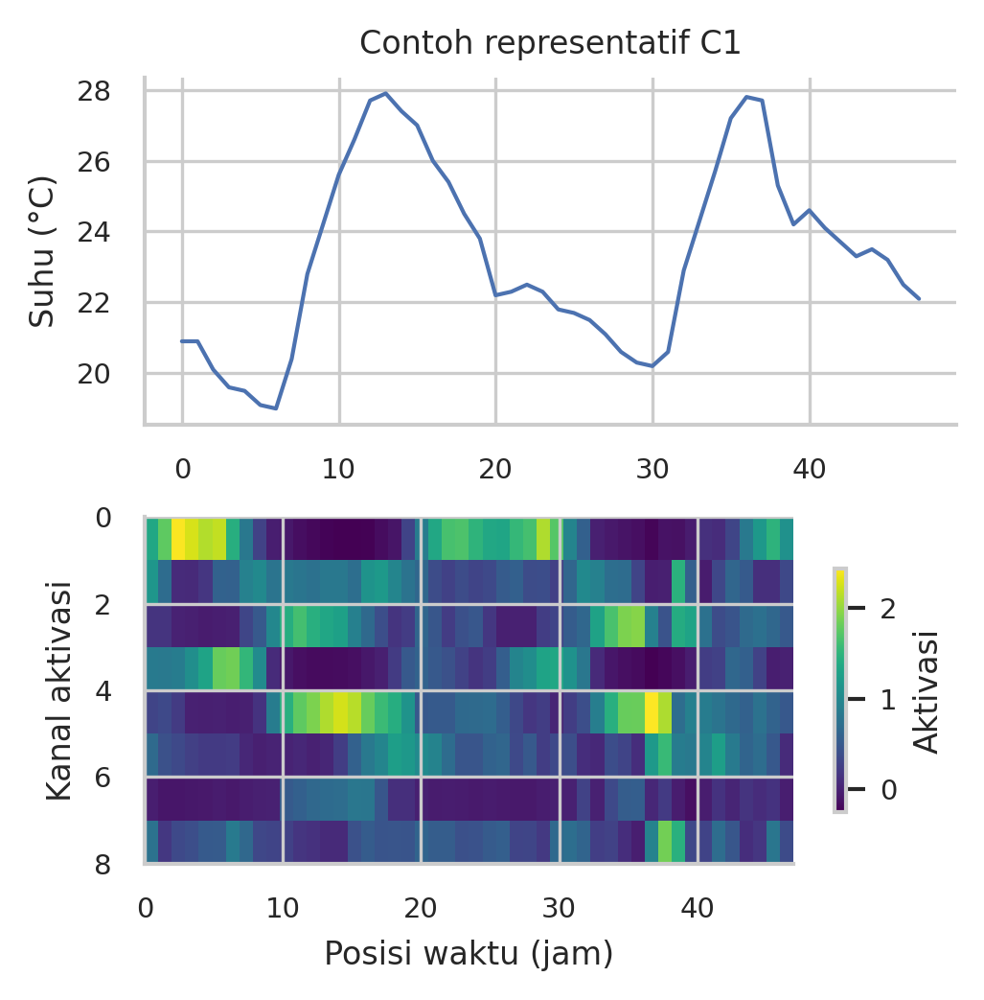
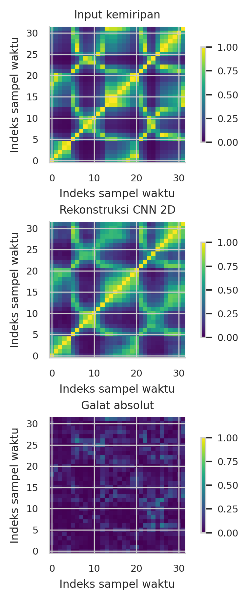

# Visualisasi Pola Time-Series Cuaca Bandung Menggunakan Convolutional Autoencoder

Ishak Palentino Napitupulu (13524022) dan Marcel Luther Sitorus (13524063)

Sistem Cerdas TF4018, Institut Teknologi Bandung, 2026

## ABSTRAK

Penelitian ini memvisualisasikan dan mengeksplorasi pola temporal cuaca Bandung melalui representasi convolutional autoencoder (CAE). Dataset mencakup 35.064 observasi hourly tahun 2022–2025. CAE 1D mempelajari tujuh variabel dalam window 48 jam; CAE 2D menjadi eksperimen pendamping pada citra kemiripan suhu. Tiga seed dilatih dengan maksimum 150 epoch dan seleksi validation-only. Embedding 1D dikelompokkan memakai K-Means dengan k yang dipilih pada validation. Model terpilih mencapai MSE rekonstruksi test 0.05781, dibandingkan 0.67258 untuk profil jam train. Dua kelompok test memiliki rentang suhu rata-rata 8.95 dan 11.57 °C serta frekuensi jam basah 31.33% dan 16.87%. Kesepakatan seluruh seed mencakup 163/182 window (89.56%), dengan ARI antar-encoder rata-rata 0.624. Hasil mendukung interpretasi gradien kondisi yang lebih lembap/berawan dan lebih besar variasi suhunya, tetapi batas kelompok masih sensitif terhadap seed. Kontribusi utama adalah hubungan terukur antara representasi CNN, profil cuaca asli, dan ketidakpastian kelompok. Penelitian bersifat eksploratif tanpa forecasting atau klaim kelas cuaca alami.

Kata kunci—cuaca Bandung; time-series; convolutional autoencoder; visualisasi; pengelompokan; stabilitas representasi.

## I. PENDAHULUAN

Grafik time-series memperlihatkan perubahan nilai cuaca dan siklus harian, tetapi pemeriksaan banyak potongan waktu multivariat secara bersamaan sulit dilakukan hanya dengan kurva panjang. Representasi yang merangkum bentuk temporal dapat membantu menelusuri kemiripan antarperiode. Tantangan akademiknya adalah menghubungkan representasi tersebut kembali ke karakteristik cuaca yang terukur, serta membedakan pola yang didukung data dari bentuk visual yang berasal dari transformasi atau inisialisasi model.

Penelitian menjawab tiga pertanyaan: (1) seberapa baik CAE mempertahankan variasi temporal pada rekonstruksi; (2) kelompok window seperti apa yang dihasilkan representasi CNN dan bagaimana profil cuaca aslinya; serta (3) seberapa konsisten kelompok tersebut pada beberapa seed dan dibanding representasi sederhana. Tujuannya adalah visualisasi dan eksplorasi pola, sehingga tidak dilakukan peramalan suhu masa depan. Rekonstruksi masukan pada waktu yang sama digunakan sebagai diagnostik kualitas representasi, bukan sebagai skor forecasting.

Kontribusi penelitian meliputi pipeline kronologis yang dapat direproduksi, visualisasi contoh nyata per kelompok, profil kuantitatif variabel cuaca, pembanding representasi, serta pemisahan ketidakstabilan encoder dari ketidakstabilan K-Means. Kelompok tidak diasumsikan sebagai musim atau kategori meteorologi sebelum karakteristik datanya diperiksa.

## II. LANDASAN METODE

Autoencoder mempelajari kode berdimensi lebih rendah dengan meminimalkan galat rekonstruksi input [2]. Konvolusi 1D mengolah lingkungan lokal sepanjang sumbu waktu, sedangkan embedding encoder dapat dipakai untuk pencarian kemiripan atau pengelompokan. Galat rendah tidak dengan sendirinya membuktikan bahwa embedding menghasilkan kelas meteorologi yang terpisah. Contoh penerapan convolutional autoencoder untuk deret waktu juga tersedia pada dokumentasi Keras [6].

PCA dipakai untuk proyeksi linear dua dimensi dan pelaporan explained variance [7]. Pengelompokan tetap dilakukan pada embedding penuh. Silhouette menilai kekompakan dan pemisahan berdasarkan geometri ruang yang dievaluasi [3]. ARI membandingkan dua partisi dengan koreksi terhadap kesepakatan kebetulan [4]; pada penelitian ini partisinya berasal dari model berbeda, bukan label ground truth.

Eksperimen pendamping menggunakan kemiripan pasangan waktu yang berkaitan dengan gagasan recurrence plot [5]. Matriks yang digunakan bersifat kontinu, S(i,j)=exp(−|u_i−u_j|/0,25), dengan u suhu hasil min–max pada satu window. Diagonal bernilai satu dan simetri berasal dari rumus tersebut. Matriks ini tidak diperlakukan sebagai recurrence plot biner atau sebagai pola yang ditemukan oleh CNN.

## III. DATA DAN METODOLOGI

### A. Sumber, lokasi, dan kualitas data

CSV mengikuti format Open-Meteo Historical Weather API [1], dengan periode 1 Januari 2022 pukul 00.00 sampai 31 Desember 2025 pukul 23.00 WIB. Metadata mencatat grid (-6.9244285, 107.60539), berjarak 1.698 km dari titik permintaan (−6,9175; 107,6191). Asia/Jakarta adalah zona waktu WIB (UTC+7), sedangkan lokasi penelitian berada di sekitar titik Bandung tersebut. Data merepresentasikan grid dan tidak diasumsikan sebagai pengukuran stasiun tepat di koordinat permintaan. Model meteorologi spesifik, URL permintaan, dan tanggal unduh tidak tercantum dalam CSV.

Tabel hourly memiliki 35.064 baris dan sembilan kolom: waktu serta delapan variabel cuaca. Tidak ditemukan missing, duplikasi timestamp, atau jam hilang pada audit. Tahun kabisat 2024 mencakup 8.784 jam. Nilai cuaca mentah dipertahankan, tanpa imputasi, clipping, penghapusan outlier, atau observasi sintetis. Dataset bersih berisi 23 kolom setelah penambahan 14 fitur kalender/siklik. Input CNN dibatasi pada suhu, kelembapan, titik embun, presipitasi, tekanan muka laut, tutupan awan, dan kecepatan angin; kode cuaca bersifat kategori dan tidak dimasukkan sebagai besaran kontinu. Kalender digunakan sebagai anotasi analisis.

Presipitasi adalah jumlah pada jam sebelumnya menurut definisi sumber [1]. Pengelompokan tanggal/bulan mengikuti label timestamp asli; pembacaan batas kalender perlu memperhatikan interval tersebut. Tekanan yang digunakan adalah pressure_msl, bukan tekanan permukaan pada elevasi Bandung. Validasi internal tidak membuktikan akurasi terhadap stasiun pengamatan.

### B. Split dan window

**TABEL 1. Pembagian waktu dan cakupan window 48 jam**

| Split | Jam | Window | Sisa jam |
| --- | --- | --- | --- |
| Train 2022–23 | 17.520 | 365 | 0 |
| Val 2024 | 8.784 | 183 | 0 |
| Test 2025 | 8.760 | 182 | 24 |

StandardScaler difit pada jam train 2022–2023 saja. Validation dan test ditransformasikan memakai parameter train. Window panjang 48 jam dan stride 48 jam dibentuk mandiri pada setiap split, dimulai pukul 00.00 WIB. Tidak ada overlap antarwindow maupun lintas split. Sebanyak 24 jam terakhir tahun 2025 tidak membentuk window lengkap dan tidak masuk evaluasi CNN; jam tersebut tetap ada dalam dataset bersih dan EDA. Bulan window ditentukan dari waktu awal; sebagian window melintasi batas bulan.

### C. Autoencoder dan protokol pelatihan

Encoder 1D: Conv(7→32,k=5,s=1,p=2), Conv(32→16,k=4,s=2,p=1), dan Conv(16→8,k=4,s=2,p=1), masing-masing diikuti LeakyReLU(0,1). Input berukuran 7×48 dikompresi menjadi 8×12 atau 96 nilai. Decoder menggunakan ConvTranspose(8→16,k=4,s=2,p=1), ConvTranspose(16→32,k=4,s=2,p=1), dan Conv(32→7,k=5,p=2). Keluaran mengembalikan ukuran input, dengan kendala domain: kelembapan/awan 0–100%, serta hujan/angin tidak negatif. Batas fisik ditransformasikan memakai statistik train dan diterapkan selama training serta inference. Kendala ini tidak mengubah atau memotong observasi input. Posisi temporal dipertahankan tanpa adaptive pooling kasar pada arsitektur lama.

Encoder 2D memakai kanal 1→8→16→8→8, dengan tiga pengurangan resolusi stride 2, menghasilkan latent 8×4×4. Decoder ConvTranspose mengembalikan resolusi 32×32 dan diakhiri Sigmoid agar sesuai target kemiripan 0–1. Input 2D menggunakan 32 sampel aktual dari suhu window 48 jam, tanpa interpolasi observasi. Normalisasi per-window menghilangkan level suhu absolut. Karena jumlah variabel dan ruang target berbeda, skor 1D dan 2D tidak dirangking langsung.

Kedua arsitektur dilatih terpisah untuk seed 42, 43, dan 44, menggunakan Adam, learning rate 0,001, weight decay 10⁻⁵, batch 32, clipping norma gradien 5, maksimum 150 epoch, dan early stopping patience 20 dengan min_delta 10⁻⁵. Checkpoint tiap seed dan seed utama dipilih berdasarkan MSE validation. MSE validation ditimbang menurut jumlah elemen, sehingga batch terakhir tidak mendapat bobot berlebihan. CPU dua thread dan algoritme deterministik diaktifkan. Perubahan arsitektur dan durasi pelatihan dilakukan bersama; peningkatan dari eksperimen lama tidak diatribusikan pada satu faktor saja.

**TABEL 2. Checkpoint terbaik menurut validation**

| Model | Seed | Epoch | MSE test |
| --- | --- | --- | --- |
| 1D | 42 | 149 | 0.06664 |
| 1D | 43 | 150 | 0.06084 |
| 1D | 44 | 150 | 0.05781 |
| 2D | 42 | 150 | 0.01134 |
| 2D | 43 | 149 | 0.01093 |
| 2D | 44 | 146 | 0.01151 |

Gambar 1. Loss rekonstruksi tiga seed CNN 1D. Pemilihan checkpoint memakai validation; penurunan pada akhir batas epoch tidak menjamin konvergensi global.

### D. Pencarian pola dan pembanding

Embedding 1D distandarkan berdasarkan embedding train lalu dikelompokkan dengan K-Means (n_init=20, seed 42). Kandidat k=2–6 dipilih memakai silhouette validation, dengan syarat tiap kelompok memiliki minimal 10 window train dan tiga window validation. Test tidak digunakan memilih k. Penomoran C1, C2, dan seterusnya diurutkan berdasarkan rerata rentang suhu kelompok train. Penamaan ini bersifat deskriptif, bukan label musim atau ground truth.

Pembanding representasi meliputi encoder 1D sebelum pelatihan, PCA input terstandardisasi dengan 96 komponen tanpa whitening, serta 28 statistik window: mean, simpangan baku, minimum, dan maksimum untuk tujuh variabel. Seluruh transformasi dan centroid difit pada train; k setiap representasi dipilih pada validation dengan aturan yang sama. Silhouette pada ruang representasi berbeda tidak merupakan ukuran universal keunggulan. Sebagai pemeriksaan tambahan, label tiap metode juga dinilai pada ruang input terstandardisasi yang sama. Tidak dilakukan uji signifikansi IID terhadap window yang masih bergantung secara temporal.

### E. Validasi pola dan interpretasi

Kestabilan encoder dinilai dengan ARI pada label test dari tiga encoder yang dilatih independen, memakai k tetap hasil pemilihan validation arsitektur tersebut. Centroid setiap encoder tetap difit pada train. Stabilitas inisialisasi K-Means diukur terpisah pada satu embedding tetap dengan lima seed. Untuk menghitung kesepakatan per window, label antar-encoder diselaraskan ke model utama menggunakan Hungarian matching pada label train; penyelarasan tidak memakai label test.

Profil kelompok dihitung dari cuaca asli dalam satuan fisik. Contoh representatif adalah window test aktual terdekat dengan centroid train pada setiap kelompok. Median dan IQR kurva digunakan sebagai ringkasan observasi, bukan data sintetis atau confidence interval. Window tanpa variasi pada suatu variabel dikecualikan hanya dari korelasi temporal variabel tersebut, karena korelasinya tidak terdefinisi; observasinya tetap disertakan pada MSE/MAE.

## IV. HASIL DAN PEMBAHASAN

### A. Pola cuaca pada data asli

EDA menghasilkan rata-rata suhu 23.025 °C dan kelembapan 79.465%. Profil rata-rata suhu mencapai maksimum sekitar pukul 12.00 WIB (27,475 °C) dan minimum sekitar 06.00 WIB (19,261 °C). Sebanyak 73,25% jam memiliki presipitasi nol. Korelasi Pearson suhu–kelembapan adalah −0,858. Temuan ini menunjukkan pola harian dan hubungan simultan yang sudah terlihat sebelum CNN. Pola tersebut tidak diklaim sebagai penemuan model; asosiasi tidak membuktikan sebab-akibat.

### B. Informasi temporal yang dipertahankan

Seed terpilih berdasarkan validation adalah 44 untuk 1D dan 43 untuk 2D. MSE test 1D sebesar 0.05781, sedangkan rerata dan SD antar-seed adalah 0.06176 ± 0.00449. Dibanding profil jam train pada window test yang sama, penurunan MSE rekonstruksi adalah 91.40%. Pembanding tidak mendapat input window aktual, sehingga hasil ini menilai retensi informasi oleh autoencoder, bukan bukti keunggulan forecasting atau representasi dibanding semua metode kompresi.

**TABEL 3. Pembanding rekonstruksi dalam ruang target masing-masing**

| Ruang | Metode | MSE test |
| --- | --- | --- |
| 1D | Rerata train | 0.94150 |
| 1D | Profil jam train | 0.67258 |
| 1D | CNN 1D | 0.05781 |
| 2D | Citra rerata train | 0.03042 |
| 2D | CNN 2D | 0.01093 |

**TABEL 4. Galat rekonstruksi fisik dan korelasi temporal 1D**

| Variabel | Unit | RMSE | r window |
| --- | --- | --- | --- |
| Suhu | °C | 0.507 | 0.980 |
| Kelembapan | % | 2.506 | 0.972 |
| Titik embun | °C | 0.370 | 0.911 |
| Presipitasi | mm | 0.255 | 0.750 |
| Tekanan MSL | hPa | 0.355 | 0.966 |
| Tutupan awan | % | 9.312 | 0.832 |
| Angin | km/jam | 1.107 | 0.899 |

RMSE pada tabel adalah galat rekonstruksi pada waktu yang sama, bukan ketidakpastian prediksi masa depan. Korelasi temporal merupakan rerata korelasi per window yang tidak konstan. Presipitasi dan tutupan awan mempunyai nilai berulang yang dapat membuat korelasi tidak terdefinisi. Jumlah window yang masuk korelasi masing-masing: Suhu 182; Kelembapan 182; Titik embun 182; Presipitasi 164; Tekanan MSL 182; Tutupan awan 180; Angin 182. Korelasi ini bersyarat pada input dan output yang tidak konstan; MSE/MAE tetap memakai seluruh 182 window. Hujan nol dominan dan puncak singkat perlu diperhatikan saat membaca rata-rata galat. Pemeriksaan batas keluaran untuk kelembapan, awan, hujan, dan angin menemukan 0 pelanggaran pada toleransi numerik 10⁻⁴ dalam satuan fisik. Ini pemeriksaan domain per variabel, bukan jaminan konsistensi semua hubungan fisik antarvariabel.

Gambar 2. Suhu asli dan rekonstruksi pada contoh aktual terdekat centroid tiap kelompok. Variasi harian kini terlihat terpulihkan; contoh tidak menggantikan evaluasi seluruh window.

### C. Kelompok pola dan ciri cuacanya

Pemilihan validation menghasilkan k=2, dengan silhouette validation 0.291 dan test 0.219 pada ruang embedding terstandardisasi. Kelompok test tidak seimbang: C1 berisi 161 dan C2 berisi 21 window. Proyeksi PCA memakai parameter train; dua komponen pertama mencakup 59.92% variasi embedding train. Kelompok didefinisikan di ruang penuh 96 dimensi, sehingga jarak pada gambar dua dimensi bukan keseluruhan jarak representasi.

Gambar 3. Proyeksi test dengan PCA train dan warna kelompok dari embedding penuh. Titik berdekatan belum otomatis berarti kondisi cuaca identik.

**TABEL 5. Profil kelompok pada seluruh window test**

| C | n | Suhu °C | Rentang °C | RH % | Basah % |
| --- | --- | --- | --- | --- | --- |
| C1 | 161 | 23.23 | 8.95 | 79.95 | 31.33 |
| C2 | 21 | 23.38 | 11.57 | 73.70 | 16.87 |

C1 memiliki kelembapan 79.95%, tutupan awan 84.40%, dan rata-rata jumlah hujan per window 48 jam 12.65 mm. C2 memiliki kelembapan 73.70%, awan 66.47%, dan hujan 10.33 mm. Rentang suhu C2 lebih besar 2.62 °C, sedangkan frekuensi jam basahnya lebih rendah 14.46 poin persentase. Profil ini mendukung istilah deskriptif 'lebih lembap/berawan dengan rentang suhu lebih kecil' untuk C1 dan 'rentang suhu lebih besar dengan lebih sedikit jam basah' untuk C2. Istilah tersebut tidak sama dengan penetapan musim hujan/kemarau atau penjelasan mekanisme penyebab.

Gambar 4. Median dan IQR suhu/kelembapan menurut posisi dalam window. Perbedaan kelompok dibaca bersama tabel fisik dan cakupan observasi.

Arah perbedaan kelompok juga muncul pada data train dan validation: kelompok berentang suhu lebih besar memiliki kelembapan dan frekuensi jam basah lebih rendah. Namun, komposisi dan intensitas hujan berubah antarperiode. Konsistensi arah deskriptif ini tidak membuktikan invariansi distribusi atau dua rezim cuaca yang benar-benar diskret.

Pada test, PC1 memiliki korelasi 0.696 dengan rentang suhu dan -0.592 dengan kelembapan rata-rata. Ini menghubungkan variasi latent dengan besaran cuaca yang dapat dibaca, tanpa menganggap PC1 sebagai sensor atau variabel fisik. Tanda sumbu PCA dapat terbalik tanpa mengubah struktur representasi; korelasi ini eksploratif dan tidak disertai p-value IID.

### D. Distribusi waktu dan pola yang berulang

Pada test 2025, kelompok C2 mencakup 26.67% window berawal Oktober, 33.33% berawal September, dan 13.33% berawal Juli. Distribusi ini merupakan pola frekuensi pada satu tahun evaluasi, bukan normal klimatologis atau bukti bahwa bulan menentukan kelompok. Jumlah window per bulan kecil dan window dapat melintasi batas bulan; persentase dibaca bersama jumlah observasinya.

Gambar 5. Frekuensi kelompok per bulan awal window test, dinormalisasi dalam setiap bulan. Nol berarti tidak ada window yang ditetapkan ke kelompok itu pada sampel tersebut.

### E. Konsistensi pola dan sumber ketidakpastian

ARI antar-encoder 1D rata-rata 0.624, dengan rentang 0.514–0.762. Pada embedding utama tetap, ARI antar-inisialisasi K-Means rata-rata 1.000. Artinya, pengulangan K-Means pada representasi yang sama jauh lebih konsisten daripada hasil dari encoder yang dilatih berbeda. Pada protokol ini ketidakpastian batas kelompok terutama berkaitan dengan variasi representasi encoder, bukan semata-mata seed K-Means. Rekonstruksi yang baik ternyata tidak menjamin partisi latent yang sama.

Setelah penyelarasan label berdasarkan train, 163 dari 182 window (89.56%) mendapat label yang sama pada ketiga seed. Sebanyak 19 window lain berubah label. Seluruh window tetap masuk hasil utama; analisis inti konsensus hanya diagnostik tambahan dan tidak dipakai untuk membuang kasus sulit atau menaikkan skor utama. Persentase ini adalah kesepakatan label, bukan akurasi; dominasi C1 membuatnya perlu dibaca bersama ARI yang mengoreksi kesepakatan kebetulan. Dua kelompok merupakan ringkasan gradien kondisi dengan batas yang belum stabil penuh.

**TABEL 6. Profil inti konsensus tiga seed (subset diagnostik)**

| C | n | Rentang °C | RH % | Awan % |
| --- | --- | --- | --- | --- |
| C1 | 148 | 8.74 | 80.53 | 86.35 |
| C2 | 15 | 12.31 | 71.21 | 59.09 |

Proporsi anggota model utama yang tetap berlabel sama pada seluruh seed adalah C1: 148/161 (91.93%); C2: 15/21 (71.43%). Perbedaan ini menunjukkan bahwa ketidakpastian batas kelompok tidak merata. Ini diagnostik representasi, bukan bukti bahwa suatu kondisi cuaca secara fisik lebih tidak pasti.

Gambar 6. ARI dari tiga pasangan encoder pada tiap arsitektur. Kesepakatan label tidak merupakan akurasi terhadap kategori meteorologi.

### F. Kontribusi CNN dibanding representasi sederhana

**TABEL 7. Pengelompokan 1D dan pembanding**

| Representasi | k | Sil. val* | Sil. input test |
| --- | --- | --- | --- |
| CNN 1D | 2 | 0.291 | 0.163 |
| CNN acak | 2 | 0.179 | 0.113 |
| PCA input | 2 | 0.231 | 0.159 |
| Statistik 28 | 2 | 0.282 | 0.133 |

*Silhouette validation dihitung pada ruang masing-masing dan digunakan memilih k, bukan merangking representasi lintas ruang. Kolom terakhir menggunakan ruang input terstandardisasi yang sama. Selisih CNN 1D terhadap PCA pada ruang bersama kecil dan belum diuji signifikansinya. Representasi sederhana juga menangkap struktur dominan; karena itu tidak diklaim CNN menemukan pola unik yang tidak dapat ditemukan metode lain. Manfaat yang didukung hasil adalah rekonstruksi temporal, visualisasi representasi, dan penelusuran kelompok kembali ke cuaca asli dengan ketidakpastian yang dinyatakan.

### G. Aktivasi dan eksperimen 2D

Visualisasi aktivasi disejajarkan dengan kurva suhu pada satu contoh representatif yang dipilih dari centroid, sehingga posisi respons dapat ditelusuri kembali ke waktu aslinya. Namun, setiap filter menerima gabungan tujuh variabel. Besarnya aktivasi tidak ditafsirkan sebagai pengaruh kausal, feature importance, atau bukti bahwa satu filter memiliki fungsi meteorologis tertentu. Evaluasi keseluruhan window tetap menjadi dasar kesimpulan.

Gambar 7. Respons delapan kanal awal CNN 1D dan suhu pada contoh representatif C1. Encoder menerima tujuh variabel sekaligus; kesesuaian posisi tidak membuktikan fungsi meteorologis satu filter.

CAE 2D mencapai MSE test 0.01093, dibanding citra rerata train 0.03042. ARI antar-encoder 2D rata-rata 0.715. Nilai ini menjelaskan kestabilan partisi untuk citra suhu ternormalisasi dan tidak dapat digunakan menyatakan 2D lebih baik daripada 1D multivariat. Bentuk diagonal serta simetri sudah ada sebelum model belajar. Perbedaan input, hilangnya level suhu, dan kompresi citra membatasi makna meteorologis perbandingan antararsitektur.

Gambar 8. Eksperimen pendamping 2D: input, rekonstruksi, dan galat absolut dengan rentang warna 0–1. Ini hubungan pasangan waktu, bukan peta geografis.

## V. KETERBATASAN DAN REPRODUKSIBILITAS

Tahun 2025 telah dibaca dalam EDA sebelumnya, sehingga evaluasi tetap bersifat eksploratif dan bukan holdout yang sepenuhnya belum dilihat. Pemilihan checkpoint, seed utama, dan k pada eksperimen ini memakai validation; keputusan protokol tetap perlu dikonfirmasi pada periode eksternal untuk klaim generalisasi. Data hanya berasal dari satu grid dan empat tahun, sementara model meteorologi sumber belum teridentifikasi. Tidak ada validasi stasiun, label kelas cuaca, atau ground truth anomali.

Window 48 jam memiliki fase awal tetap dan belum dibandingkan secara sistematis dengan panjang/offset lain. Tiga seed hanya memberi pemeriksaan awal ketidakpastian, bukan estimasi lengkap distribusi model. Kandidat k dibatasi 2–6; hasil k=2 tidak membuktikan jumlah kelas alami adalah dua. Banyak run mencapai batas 150 epoch; hasil tidak diklaim optimum global. Perbaikan rekonstruksi juga tidak otomatis menyelesaikan ketidakstabilan embedding.

Seluruh angka dan grafik dibangun dari CSV/tensor tersimpan, dengan metadata window, scaler train, checkpoint per seed, label tiap window, kandidat k validation, profil kelompok, dan manifest SHA-256. Kode sumber, lingkungan paket, serta script pembangun PDF disertakan dalam repository. Gambar utama berasal dari PNG 300 dpi. Laporan 01–06 merupakan dokumentasi historis tahap persiapan; laporan ini menetapkan tujuan aktif representasi dan pencarian pola.

## VI. KESIMPULAN

CAE 1D dapat mempertahankan variasi temporal cuaca pada rekonstruksi, dengan MSE test 0.05781 dan profil kelompok yang dapat dijelaskan melalui rentang suhu, kelembapan, awan, dan frekuensi jam basah. Dua kelompok terpilih merangkum perbedaan kondisi yang lebih lembap/berawan dan kondisi dengan variasi suhu lebih besar. Sebanyak 89.56% window memperoleh label sama pada tiga seed, tetapi ARI rata-rata 0.624 menunjukkan batas kelompok masih sensitif terhadap encoder. Pola deskriptif memiliki dukungan angka, sementara klaim dua kelas cuaca alami, keunggulan universal CNN, atau konsistensi sempurna tidak didukung. Penelitian menghasilkan visualisasi pola beserta ketidakpastiannya; konfirmasi lintas periode, seed, dan panjang window menjadi langkah berikutnya yang terpisah dari hasil sekarang.

## DAFTAR PUSTAKA

[1] Open-Meteo, “Historical Weather API.” https://open-meteo.com/en/docs/historical-weather-api, diakses 5 November 2026.

[2] G. E. Hinton dan R. R. Salakhutdinov, “Reducing the Dimensionality of Data with Neural Networks,” Science, vol. 313, no. 5786, hlm. 504–507, 2006. doi:10.1126/science.1127647.

[3] P. J. Rousseeuw, “Silhouettes: A graphical aid to the interpretation and validation of cluster analysis,” Journal of Computational and Applied Mathematics, vol. 20, hlm. 53–65, 1987. doi:10.1016/0377-0427(87)90125-7.

[4] L. Hubert dan P. Arabie, “Comparing partitions,” Journal of Classification, vol. 2, hlm. 193–218, 1985. doi:10.1007/BF01908075.

[5] J.-P. Eckmann, S. O. Kamphorst, dan D. Ruelle, “Recurrence Plots of Dynamical Systems,” Europhysics Letters, vol. 4, no. 9, hlm. 973–977, 1987. doi:10.1209/0295-5075/4/9/004.

[6] P. Vijay, “Timeseries anomaly detection using an Autoencoder,” Keras Code Examples, 2020. https://keras.io/examples/timeseries/timeseries_anomaly_detection/, diakses 5 November 2026.

[7] scikit-learn developers, “Principal component analysis” dan “Clustering performance evaluation.” https://scikit-learn.org/stable/modules/decomposition.html dan https://scikit-learn.org/stable/modules/clustering.html, diakses 5 November 2026.

## LAMPIRAN: PETA ARTEFAK

Sumber utama: src/stage6_cnn_experiments.py; src/stage7_visual_interpretation.py; src/build_ieee_report.py; src/verify_cnn_results.py. Data bersih: data/processed/bandung_weather_hourly_clean.csv. Perintah lengkap dan versi dependency tersedia dalam README.md dan requirements.txt.

Angka utama: output/cnn/results.json dan pattern_results.json. Pemeriksaan pola: cluster_weather_profiles.csv, cluster_stability.csv, encoder_seed_window_agreement.csv, consensus_core_weather_profiles.csv, cluster_model_comparison.csv, dan latent_weather_associations.csv. Penelusuran waktu memakai window_metadata.csv dan window_cluster_assignments.csv. Manifest eksperimen dan pola menyediakan hash setiap artefak.

Laporan PDF dan Markdown pendamping bernama sama dihasilkan bersama dari artefak numerik melalui script pembangun laporan. Versi sebelum revisi tersimpan di reports/archive; keluaran eksperimen tiga epoch berada di output/cnn/legacy_smoke_test. Repository pengembangan: https://github.com/Ishakpln/bandung-weather-timeseries-cnn. Versi yang menghasilkan laporan ini ditentukan oleh hash kode dan artefak dalam manifest pendamping.
