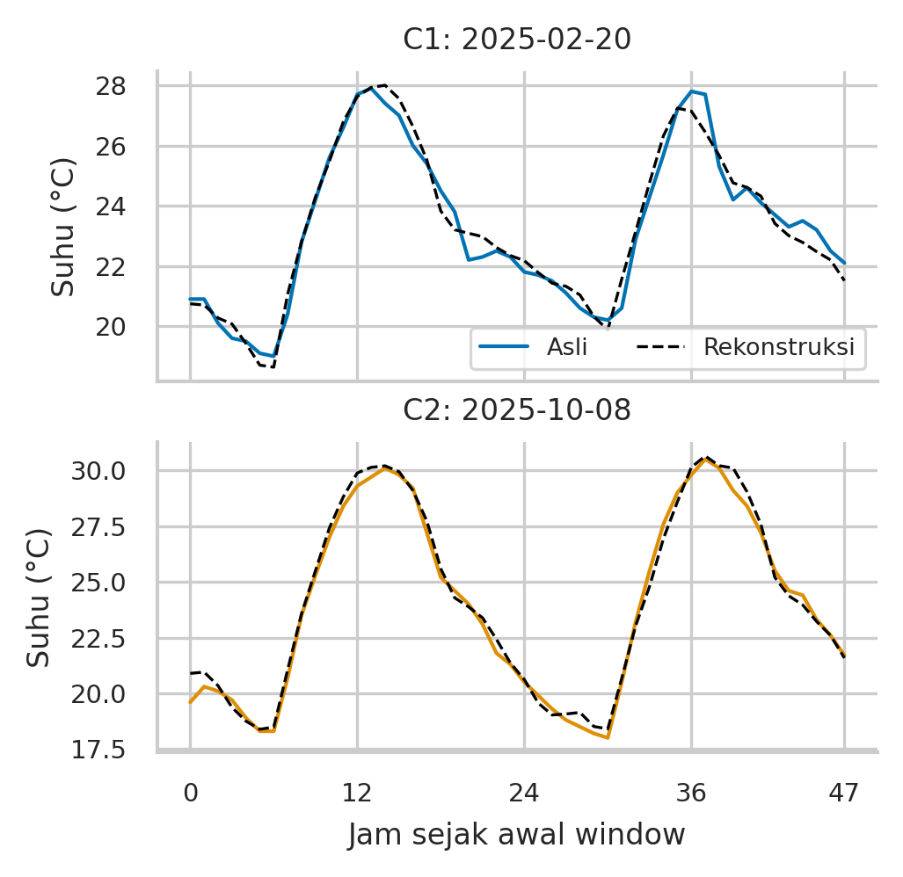
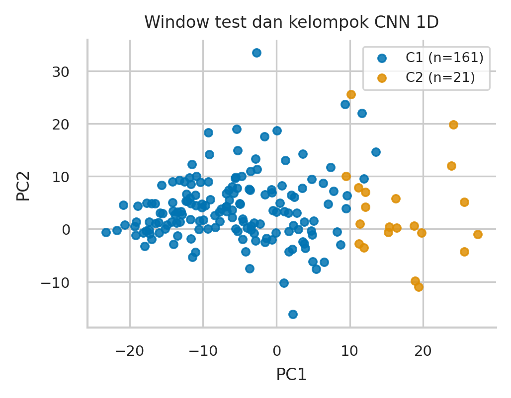
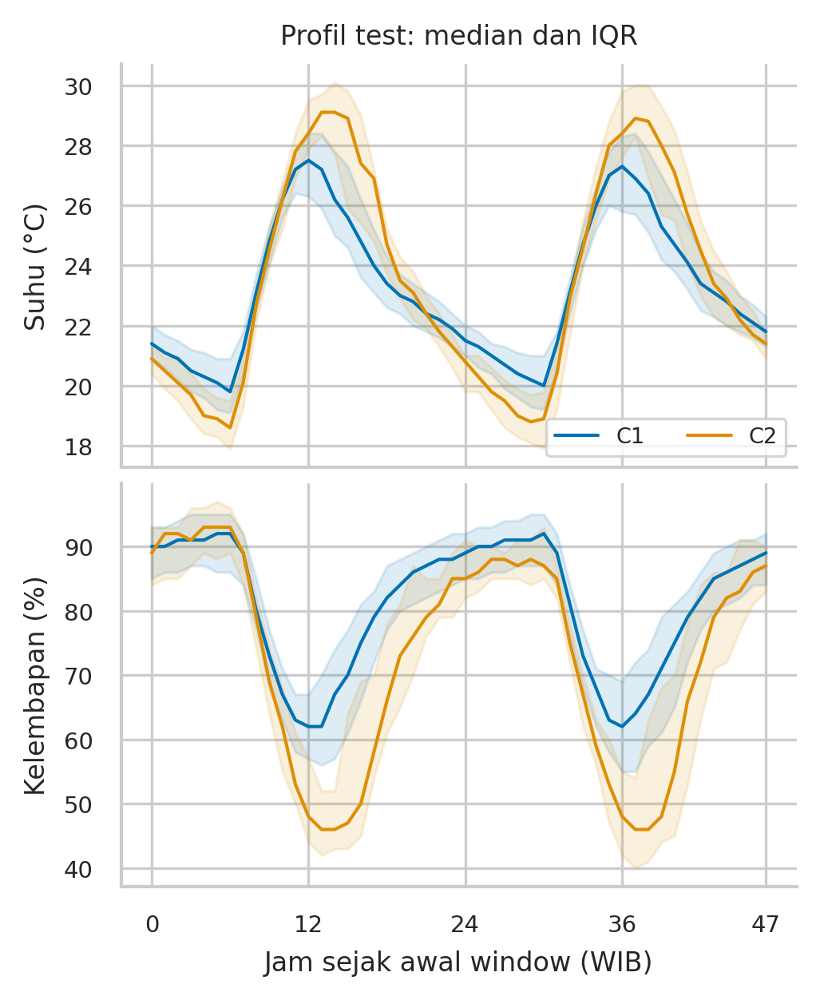
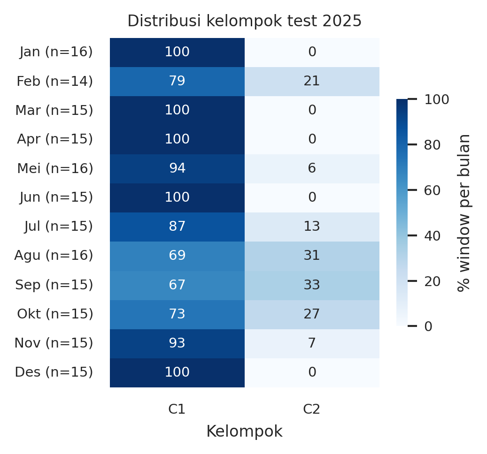
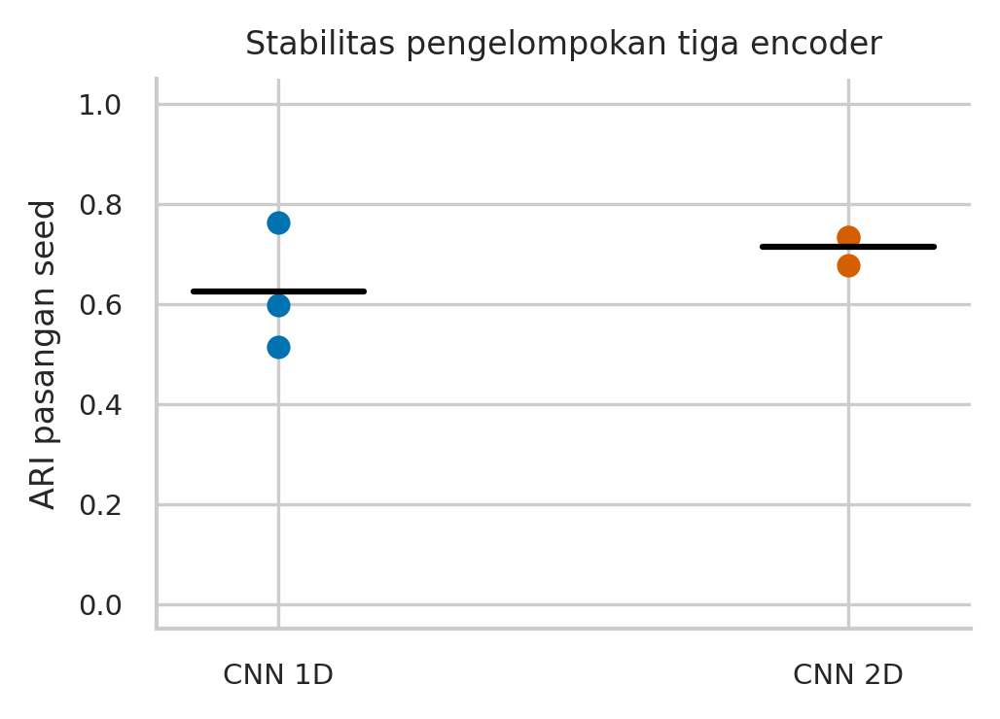
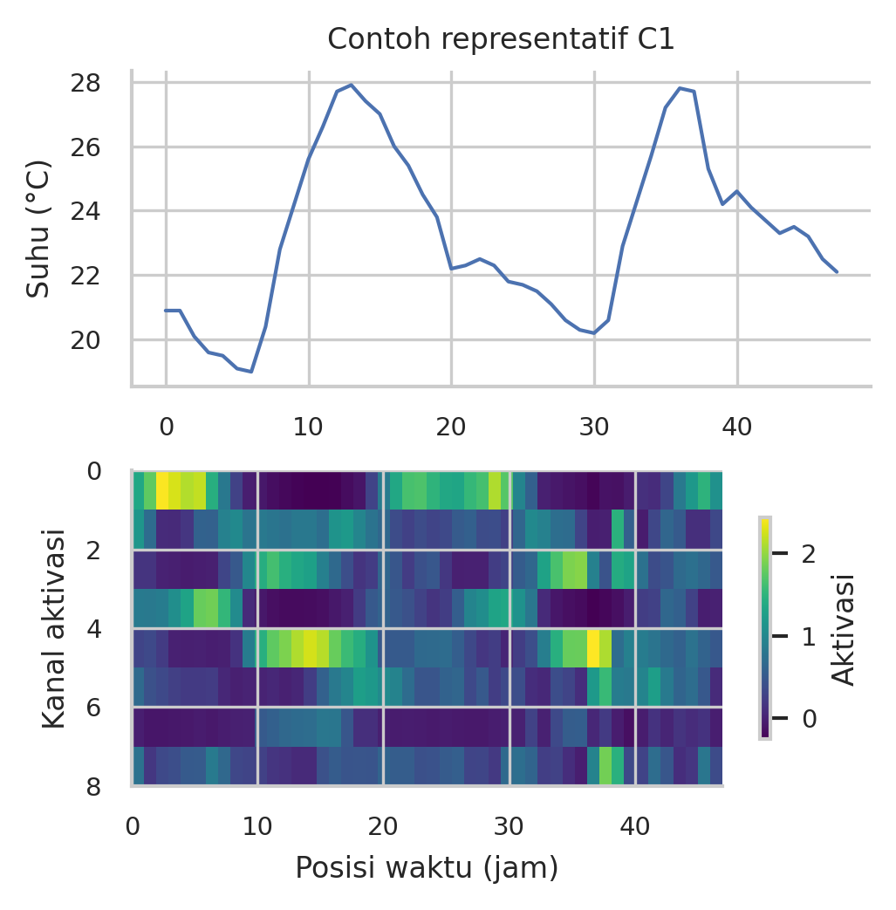
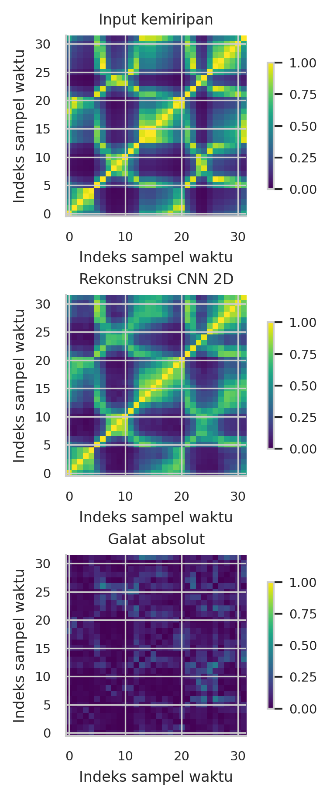

# Analisis pola dan validasi representasi CNN

Ringkasan hasil dan batas interpretasi dari laporan utama. Metodologi lengkap dan daftar pustaka tersedia pada [13524022_13524063_Visualisasi_CNN_IEEE_Format.md](13524022_13524063_Visualisasi_CNN_IEEE_Format.md).

### A. Pola cuaca pada data asli

EDA menghasilkan rata-rata suhu 23.025 °C dan kelembapan 79.465%. Profil rata-rata suhu mencapai maksimum sekitar pukul 12.00 WIB (27,475 °C) dan minimum sekitar 06.00 WIB (19,261 °C). Sebanyak 73,25% jam memiliki presipitasi nol. Korelasi Pearson suhu–kelembapan adalah −0,858. Temuan ini menunjukkan pola harian dan hubungan simultan yang sudah terlihat sebelum CNN. Pola tersebut tidak diklaim sebagai penemuan model; asosiasi tidak membuktikan sebab-akibat.

### B. Informasi temporal yang dipertahankan

Seed terpilih berdasarkan validation adalah 44 untuk 1D dan 43 untuk 2D. MSE test 1D sebesar 0.05781, sedangkan rerata dan SD antar-seed adalah 0.06176 ± 0.00449. Dibanding profil jam train pada window test yang sama, penurunan MSE rekonstruksi adalah 91.40%. Pembanding tidak mendapat input window aktual, sehingga hasil ini menilai retensi informasi oleh autoencoder, bukan bukti keunggulan forecasting atau representasi dibanding semua metode kompresi.

**TABEL 3. Pembanding rekonstruksi dalam ruang target masing-masing**

| Ruang | Metode | MSE test |
| --- | --- | --- |
| 1D | Rerata train | 0.94150 |
| 1D | Profil jam train | 0.67258 |
| 1D | CNN 1D | 0.05781 |
| 2D | Citra rerata train | 0.03042 |
| 2D | CNN 2D | 0.01093 |

**TABEL 4. Galat rekonstruksi fisik dan korelasi temporal 1D**

| Variabel | Unit | RMSE | r window |
| --- | --- | --- | --- |
| Suhu | °C | 0.507 | 0.980 |
| Kelembapan | % | 2.506 | 0.972 |
| Titik embun | °C | 0.370 | 0.911 |
| Presipitasi | mm | 0.255 | 0.750 |
| Tekanan MSL | hPa | 0.355 | 0.966 |
| Tutupan awan | % | 9.312 | 0.832 |
| Angin | km/jam | 1.107 | 0.899 |

RMSE pada tabel adalah galat rekonstruksi pada waktu yang sama, bukan ketidakpastian prediksi masa depan. Korelasi temporal merupakan rerata korelasi per window yang tidak konstan. Presipitasi dan tutupan awan mempunyai nilai berulang yang dapat membuat korelasi tidak terdefinisi. Jumlah window yang masuk korelasi masing-masing: Suhu 182; Kelembapan 182; Titik embun 182; Presipitasi 164; Tekanan MSL 182; Tutupan awan 180; Angin 182. Korelasi ini bersyarat pada input dan output yang tidak konstan; MSE/MAE tetap memakai seluruh 182 window. Hujan nol dominan dan puncak singkat perlu diperhatikan saat membaca rata-rata galat. Pemeriksaan batas keluaran untuk kelembapan, awan, hujan, dan angin menemukan 0 pelanggaran pada toleransi numerik 10⁻⁴ dalam satuan fisik. Ini pemeriksaan domain per variabel, bukan jaminan konsistensi semua hubungan fisik antarvariabel.

Gambar 2. Suhu asli dan rekonstruksi pada contoh aktual terdekat centroid tiap kelompok. Variasi harian kini terlihat terpulihkan; contoh tidak menggantikan evaluasi seluruh window.

### C. Kelompok pola dan ciri cuacanya

Pemilihan validation menghasilkan k=2, dengan silhouette validation 0.291 dan test 0.219 pada ruang embedding terstandardisasi. Kelompok test tidak seimbang: C1 berisi 161 dan C2 berisi 21 window. Proyeksi PCA memakai parameter train; dua komponen pertama mencakup 59.92% variasi embedding train. Kelompok didefinisikan di ruang penuh 96 dimensi, sehingga jarak pada gambar dua dimensi bukan keseluruhan jarak representasi.

Gambar 3. Proyeksi test dengan PCA train dan warna kelompok dari embedding penuh. Titik berdekatan belum otomatis berarti kondisi cuaca identik.

**TABEL 5. Profil kelompok pada seluruh window test**

| C | n | Suhu °C | Rentang °C | RH % | Basah % |
| --- | --- | --- | --- | --- | --- |
| C1 | 161 | 23.23 | 8.95 | 79.95 | 31.33 |
| C2 | 21 | 23.38 | 11.57 | 73.70 | 16.87 |

C1 memiliki kelembapan 79.95%, tutupan awan 84.40%, dan rata-rata jumlah hujan per window 48 jam 12.65 mm. C2 memiliki kelembapan 73.70%, awan 66.47%, dan hujan 10.33 mm. Rentang suhu C2 lebih besar 2.62 °C, sedangkan frekuensi jam basahnya lebih rendah 14.46 poin persentase. Profil ini mendukung istilah deskriptif 'lebih lembap/berawan dengan rentang suhu lebih kecil' untuk C1 dan 'rentang suhu lebih besar dengan lebih sedikit jam basah' untuk C2. Istilah tersebut tidak sama dengan penetapan musim hujan/kemarau atau penjelasan mekanisme penyebab.

Gambar 4. Median dan IQR suhu/kelembapan menurut posisi dalam window. Perbedaan kelompok dibaca bersama tabel fisik dan cakupan observasi.

Arah perbedaan kelompok juga muncul pada data train dan validation: kelompok berentang suhu lebih besar memiliki kelembapan dan frekuensi jam basah lebih rendah. Namun, komposisi dan intensitas hujan berubah antarperiode. Konsistensi arah deskriptif ini tidak membuktikan invariansi distribusi atau dua rezim cuaca yang benar-benar diskret.

Pada test, PC1 memiliki korelasi 0.696 dengan rentang suhu dan -0.592 dengan kelembapan rata-rata. Ini menghubungkan variasi latent dengan besaran cuaca yang dapat dibaca, tanpa menganggap PC1 sebagai sensor atau variabel fisik. Tanda sumbu PCA dapat terbalik tanpa mengubah struktur representasi; korelasi ini eksploratif dan tidak disertai p-value IID.

### D. Distribusi waktu dan pola yang berulang

Pada test 2025, kelompok C2 mencakup 26.67% window berawal Oktober, 33.33% berawal September, dan 13.33% berawal Juli. Distribusi ini merupakan pola frekuensi pada satu tahun evaluasi, bukan normal klimatologis atau bukti bahwa bulan menentukan kelompok. Jumlah window per bulan kecil dan window dapat melintasi batas bulan; persentase dibaca bersama jumlah observasinya.

Gambar 5. Frekuensi kelompok per bulan awal window test, dinormalisasi dalam setiap bulan. Nol berarti tidak ada window yang ditetapkan ke kelompok itu pada sampel tersebut.

### E. Konsistensi pola dan sumber ketidakpastian

ARI antar-encoder 1D rata-rata 0.624, dengan rentang 0.514–0.762. Pada embedding utama tetap, ARI antar-inisialisasi K-Means rata-rata 1.000. Artinya, pengulangan K-Means pada representasi yang sama jauh lebih konsisten daripada hasil dari encoder yang dilatih berbeda. Pada protokol ini ketidakpastian batas kelompok terutama berkaitan dengan variasi representasi encoder, bukan semata-mata seed K-Means. Rekonstruksi yang baik ternyata tidak menjamin partisi latent yang sama.

Setelah penyelarasan label berdasarkan train, 163 dari 182 window (89.56%) mendapat label yang sama pada ketiga seed. Sebanyak 19 window lain berubah label. Seluruh window tetap masuk hasil utama; analisis inti konsensus hanya diagnostik tambahan dan tidak dipakai untuk membuang kasus sulit atau menaikkan skor utama. Persentase ini adalah kesepakatan label, bukan akurasi; dominasi C1 membuatnya perlu dibaca bersama ARI yang mengoreksi kesepakatan kebetulan. Dua kelompok merupakan ringkasan gradien kondisi dengan batas yang belum stabil penuh.

**TABEL 6. Profil inti konsensus tiga seed (subset diagnostik)**

| C | n | Rentang °C | RH % | Awan % |
| --- | --- | --- | --- | --- |
| C1 | 148 | 8.74 | 80.53 | 86.35 |
| C2 | 15 | 12.31 | 71.21 | 59.09 |

Proporsi anggota model utama yang tetap berlabel sama pada seluruh seed adalah C1: 148/161 (91.93%); C2: 15/21 (71.43%). Perbedaan ini menunjukkan bahwa ketidakpastian batas kelompok tidak merata. Ini diagnostik representasi, bukan bukti bahwa suatu kondisi cuaca secara fisik lebih tidak pasti.

Gambar 6. ARI dari tiga pasangan encoder pada tiap arsitektur. Kesepakatan label tidak merupakan akurasi terhadap kategori meteorologi.

### F. Kontribusi CNN dibanding representasi sederhana

**TABEL 7. Pengelompokan 1D dan pembanding**

| Representasi | k | Sil. val* | Sil. input test |
| --- | --- | --- | --- |
| CNN 1D | 2 | 0.291 | 0.163 |
| CNN acak | 2 | 0.179 | 0.113 |
| PCA input | 2 | 0.231 | 0.159 |
| Statistik 28 | 2 | 0.282 | 0.133 |

*Silhouette validation dihitung pada ruang masing-masing dan digunakan memilih k, bukan merangking representasi lintas ruang. Kolom terakhir menggunakan ruang input terstandardisasi yang sama. Selisih CNN 1D terhadap PCA pada ruang bersama kecil dan belum diuji signifikansinya. Representasi sederhana juga menangkap struktur dominan; karena itu tidak diklaim CNN menemukan pola unik yang tidak dapat ditemukan metode lain. Manfaat yang didukung hasil adalah rekonstruksi temporal, visualisasi representasi, dan penelusuran kelompok kembali ke cuaca asli dengan ketidakpastian yang dinyatakan.

### G. Aktivasi dan eksperimen 2D

Visualisasi aktivasi disejajarkan dengan kurva suhu pada satu contoh representatif yang dipilih dari centroid, sehingga posisi respons dapat ditelusuri kembali ke waktu aslinya. Namun, setiap filter menerima gabungan tujuh variabel. Besarnya aktivasi tidak ditafsirkan sebagai pengaruh kausal, feature importance, atau bukti bahwa satu filter memiliki fungsi meteorologis tertentu. Evaluasi keseluruhan window tetap menjadi dasar kesimpulan.

Gambar 7. Respons delapan kanal awal CNN 1D dan suhu pada contoh representatif C1. Encoder menerima tujuh variabel sekaligus; kesesuaian posisi tidak membuktikan fungsi meteorologis satu filter.

CAE 2D mencapai MSE test 0.01093, dibanding citra rerata train 0.03042. ARI antar-encoder 2D rata-rata 0.715. Nilai ini menjelaskan kestabilan partisi untuk citra suhu ternormalisasi dan tidak dapat digunakan menyatakan 2D lebih baik daripada 1D multivariat. Bentuk diagonal serta simetri sudah ada sebelum model belajar. Perbedaan input, hilangnya level suhu, dan kompresi citra membatasi makna meteorologis perbandingan antararsitektur.

Gambar 8. Eksperimen pendamping 2D: input, rekonstruksi, dan galat absolut dengan rentang warna 0–1. Ini hubungan pasangan waktu, bukan peta geografis.

## V. KETERBATASAN DAN REPRODUKSIBILITAS

Tahun 2025 telah dibaca dalam EDA sebelumnya, sehingga evaluasi tetap bersifat eksploratif dan bukan holdout yang sepenuhnya belum dilihat. Pemilihan checkpoint, seed utama, dan k pada eksperimen ini memakai validation; keputusan protokol tetap perlu dikonfirmasi pada periode eksternal untuk klaim generalisasi. Data hanya berasal dari satu grid dan empat tahun, sementara model meteorologi sumber belum teridentifikasi. Tidak ada validasi stasiun, label kelas cuaca, atau ground truth anomali.

Window 48 jam memiliki fase awal tetap dan belum dibandingkan secara sistematis dengan panjang/offset lain. Tiga seed hanya memberi pemeriksaan awal ketidakpastian, bukan estimasi lengkap distribusi model. Kandidat k dibatasi 2–6; hasil k=2 tidak membuktikan jumlah kelas alami adalah dua. Banyak run mencapai batas 150 epoch; hasil tidak diklaim optimum global. Perbaikan rekonstruksi juga tidak otomatis menyelesaikan ketidakstabilan embedding.

Seluruh angka dan grafik dibangun dari CSV/tensor tersimpan, dengan metadata window, scaler train, checkpoint per seed, label tiap window, kandidat k validation, profil kelompok, dan manifest SHA-256. Kode sumber, lingkungan paket, serta script pembangun PDF disertakan dalam repository. Gambar utama berasal dari PNG 300 dpi. Laporan 01–06 merupakan dokumentasi historis tahap persiapan; laporan ini menetapkan tujuan aktif representasi dan pencarian pola.
